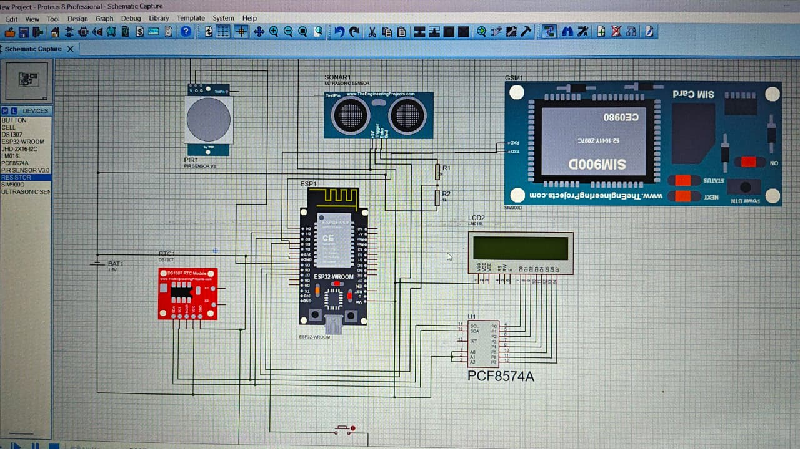
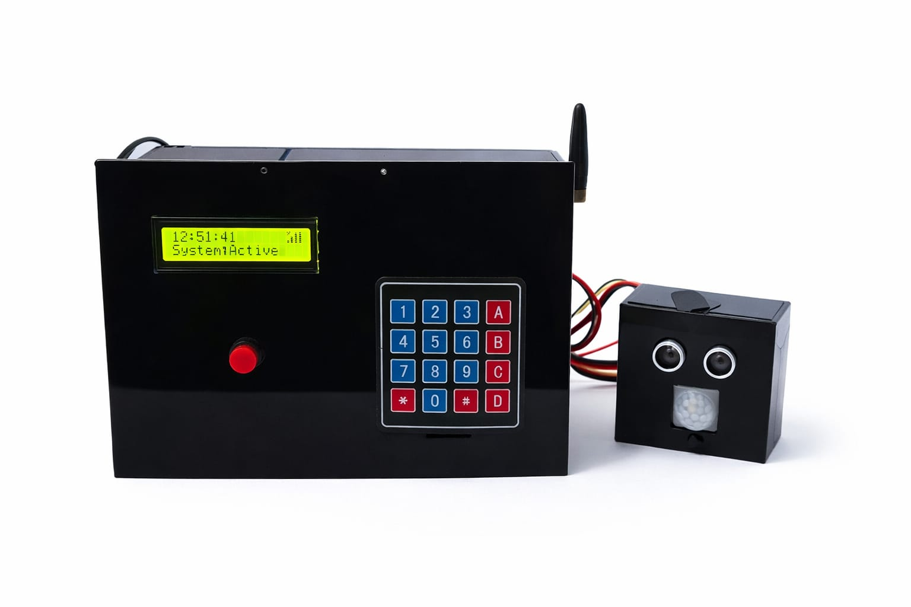
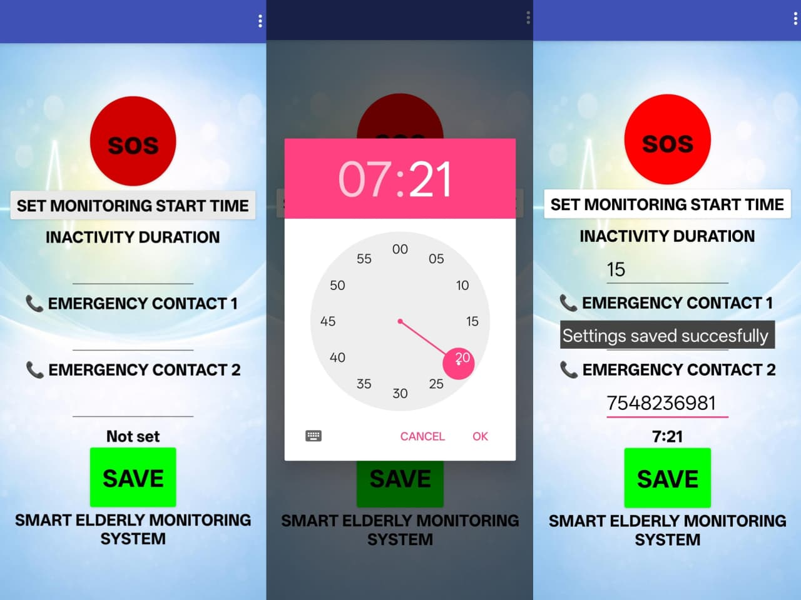
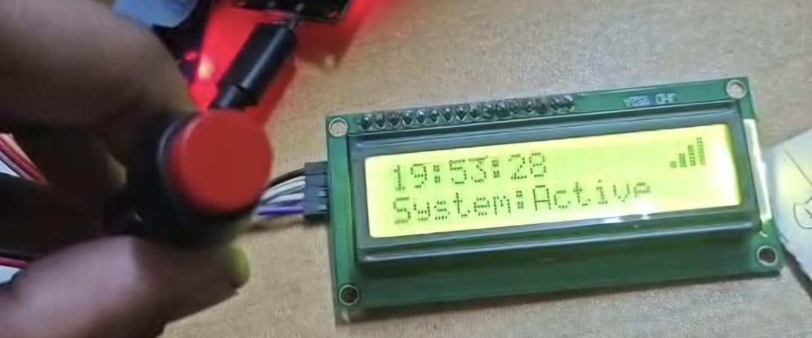
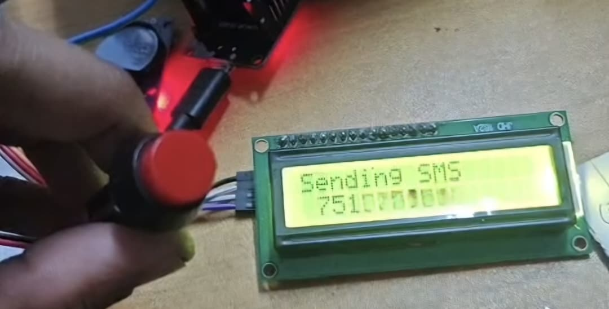

# Smart Monitoring System for Solitary-Living and Elderly Individuals

An IoT-based, non-wearable smart monitoring system designed to enhance the safety and well-being of elderly individuals and people living alone through scheduled activity monitoring, sensor-based detection, and automated emergency alerts.

  <b>ESP32 | PIR Sensor | Ultrasonic Sensor | RTC | GSM | SoloCare Mobile Application</b>

---

## 1. Introduction

Individuals living alone, particularly elderly people, may face safety risks during emergencies when immediate assistance is unavailable. Conventional monitoring solutions often rely on wearable devices, which may be uncomfortable or inconvenient for continuous use.

The **Smart Monitoring System for Solitary-Living and Elderly Individuals** provides a non-wearable approach to monitoring user activity during predefined time intervals.

The system uses an ESP32 microcontroller integrated with PIR and ultrasonic sensors to detect human activity. An RTC module enables scheduled monitoring, while a GSM module facilitates emergency SMS notifications and calls when abnormal inactivity or an SOS condition is detected.

The system also incorporates a keypad for emergency contact configuration, an LCD for displaying system status, and a dedicated SoloCare mobile application for user interaction.

## 2. Objectives

- Develop a non-wearable monitoring system for elderly and solitary-living individuals.
- Monitor human activity during predefined time intervals.
- Detect potential abnormal inactivity using PIR and ultrasonic sensors.
- Implement scheduled monitoring using a Real-Time Clock (RTC).
- Generate emergency alerts through GSM communication.
- Provide manual emergency activation through an SOS button.
- Enable emergency contact configuration using a keypad.
- Provide system status information through an LCD and mobile application.

## 3. Key Features

- **Non-Wearable Monitoring:** Monitors activity without requiring the user to wear a device.
- **Scheduled Activity Monitoring:** Activates monitoring during predefined time periods.
- **Sensor-Based Activity Detection:** Combines PIR motion detection and ultrasonic distance measurement.
- **Automatic Emergency Alerts:** Sends SMS notifications and initiates calls through the GSM module when abnormal inactivity is detected.
- **Manual SOS Facility:** Allows the user to trigger an emergency alert manually.
- **Emergency Contact Configuration:** Enables contact entry and modification through a keypad.
- **Real-Time Clock:** Provides time-based monitoring and scheduling.
- **LCD Status Display:** Displays monitoring status and emergency messages.
- **SoloCare Mobile Application:** Provides a mobile interface for configuring monitoring parameters and emergency contacts.

## 4. System Architecture

The ESP32 acts as the central processing unit of the system. It receives inputs from the PIR sensor, ultrasonic sensor, RTC module, keypad and SOS button.

Based on the sensor inputs and scheduled monitoring parameters, the ESP32 determines the user's activity status. When an abnormal condition is identified, the GSM module is activated to send emergency notifications and initiate calls to registered contacts.

The LCD provides local status information, while the SoloCare mobile application communicates with the ESP32 for monitoring configuration and user interaction.

## 5. Hardware Requirements

| Component | Function |
|---|---|
| ESP32 Microcontroller | Main processing and control unit |
| PIR Sensor | Detects human motion |
| Ultrasonic Sensor | Measures distance and detects distance variations |
| RTC Module | Maintains real-time clock information |
| GSM Module | Sends emergency SMS and makes calls |
| Keypad | Allows emergency contact and parameter entry |
| SOS Button | Manual emergency activation |
| 16×2 LCD Display | Displays system status and messages |
| EEPROM | Stores monitoring settings and emergency contact information |
| Buzzer | Provides local audible emergency alerts |

## 6. Software Requirements

- Arduino IDE
- Embedded C/C++ (Arduino framework)
- ESP32 Board Package
- Required Arduino libraries:
  - Wire
  - WiFi
  - WebServer
  - RTClib
  - Keypad
  - LiquidCrystal_I2C

## 7. Working Principle

The system operates through the following stages:

1. **System Initialization:** The ESP32 initializes the connected sensors, RTC, GSM module, keypad, buzzer and LCD.
2. **Time-Based Monitoring:** The RTC provides the current time, which is compared with the predefined monitoring schedule.
3. **Activity Detection:** PIR and ultrasonic sensors monitor movement and distance variations within the monitored environment.
4. **Activity Evaluation:** The ESP32 processes the sensor readings to identify valid activity.
5. **Abnormal Inactivity Detection:** If the required activity is not detected within the specified monitoring duration, the system identifies a potential abnormal condition.
6. **Emergency Alert Generation:** The GSM module sends SMS alerts and initiates calls to the stored emergency contacts. The buzzer also provides an audible alert.
7. **Manual Emergency Activation:** The user can activate the SOS button to trigger an emergency alert independently of sensor detection.

## 8. Circuit Diagram

  

*Circuit diagram showing the hardware connections of the Smart Monitoring System.*

## 9. Hardware Prototype

  

*Developed hardware prototype of the elderly monitoring system.*

## 10. SoloCare Mobile Application

The SoloCare mobile application provides an interface for configuring monitoring parameters and emergency contact information.

  

## 11. Monitoring Dashboard

The monitoring dashboard provides an interface for interacting with the ESP32-based monitoring system.

  

## 12. System Outputs

The following images show the outputs obtained during the operation of the developed prototype.

  
   
  <em>Output 1 – System monitoring in the LCD display</em>

  
   
  <em>Output 2 – System status display</em>

## 13. Source Code

The ESP32 source code is available in this repository:

[Smart Elderly Monitoring System – Source Code](Smart_Elderly_Monitoring_System.c)

The code implements:
- Sensor interfacing and activity detection.
- Scheduled monitoring using RTC.
- GSM-based emergency communication.
- Keypad-based configuration.
- EEPROM data storage.
- LCD status updates.
- ESP32 Wi-Fi communication and web server functionality.

## 14. How to Run the Project

1. Install the Arduino IDE.
2. Install the ESP32 board package.
3. Install the required libraries.
4. Download the source code from this repository.
5. Open the sketch in Arduino IDE (save the downloaded source with the `.ino` extension if necessary).
6. Configure the Wi-Fi credentials and access-point settings in the code.
7. Connect the ESP32 and the required hardware modules according to the circuit diagram.
8. Configure the monitoring schedule and emergency contact numbers.
9. Upload the program to the ESP32.
10. Power the system and verify the monitoring and emergency alert functions.

**Note:** Replace the configuration placeholders with your own settings before running the program. Do not publish personal Wi-Fi credentials or emergency contact numbers.

## 15. Project Documentation

The complete project report is available below.

📄 [Download Project Report – PDF](Smart_Elderly_Monitoring_Project_Report.pdf)

The report contains the introduction, literature review, system design, working principle, hardware descriptions, implementation, results and conclusion.

## 16. Future Scope

- Integration of additional health-monitoring sensors.
- Improved activity recognition and abnormal-condition detection.
- Enhanced mobile application functionality.
- Cloud-based monitoring and remote data access.
- Improved emergency notification and caregiver communication.
- Further optimization of reliability and monitoring accuracy.

## 17. Contributors

Developed as a B.Tech Mini Project at the Department of Electronics and Communication Engineering, Rajiv Gandhi Institute of Technology, Kottayam.

- **Adithyan P.U.**
- **Adhila Fathima T.A.**
- **Nandanalakshmi P.H.**
- **Nandana Nair**

**Institution:** Rajiv Gandhi Institute of Technology, Kottayam  
**Academic Year:** 2025–2026

---

  <b>Smart Monitoring System for Solitary-Living and Elderly Individuals</b>
   
  <i>Promoting independent living through intelligent monitoring and emergency assistance.</i>

